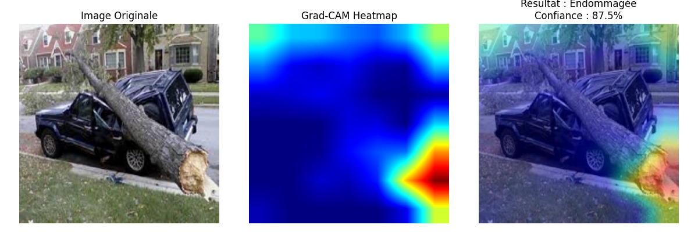
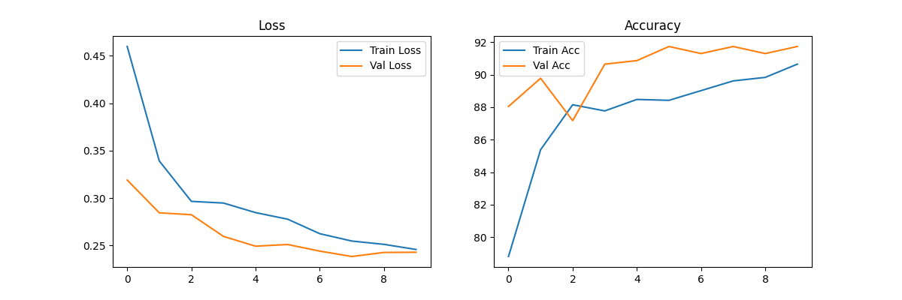

# Détection de dommages automobiles et estimation du coût

**Fatima Zahra Houqqa** · Projet universitaire de Deep Learning, 2026
[Portfolio](https://houqqa-fatimazahra.github.io) · [LinkedIn](https://linkedin.com/in/houqqa-fatimazahra) · [Autre projet : pipeline MLOps](https://github.com/houqqa-fatimazahra/tp-mlops)

> **EN —** A computer vision app that classifies a car photo as damaged or intact with an EfficientNet-B0 fine-tuned by transfer learning (**91.2% validation accuracy, 0.91 F1**), explains each prediction with **Grad-CAM**, estimates a repair cost range and answers questions through a small rule-based chatbot, all served by a **Flask** web app.

L'utilisateur envoie une photo de véhicule ; l'application renvoie le diagnostic (endommagé / intact), le niveau de confiance, la carte de chaleur Grad-CAM et une fourchette de coût de réparation.



## Résultats (jeu de validation)

| Métrique | Entraînement | Validation |
|---|---|---|
| Accuracy | 90,3 % | **91,2 %** |
| Précision | 91,5 % | 90,8 % |
| Rappel | 89,7 % | 91,5 % |
| F1 | 90,6 % | **91,1 %** |

Courbes d'apprentissage sur 10 époques : la perte de validation reste sous la perte d'entraînement, sans signe de surapprentissage.



## Comment ça marche

| Fichier | Rôle |
|---|---|
| [`train.py`](train.py) | EfficientNet-B0 pré-entraîné sur ImageNet ; couches gelées, nouvelle tête à 2 classes ; augmentation (retournement, rotation, luminosité) ; Adam, 10 époques |
| [`gradcam.py`](gradcam.py) | Grad-CAM sur la dernière couche convolutive : zones de l'image qui ont pesé dans la décision |
| [`price.py`](price.py) | Fourchette de coût en dirhams selon le diagnostic et la confiance (règles simples) |
| [`app.py`](app.py) | Application Flask : analyse d'image, historique et chatbot d'aide à base de mots-clés |
| [`templates/`](templates/), [`static/`](static/) | Interface web |
| `models/car_damage_model.pth` | Poids du modèle entraîné (16 Mo) |

## Lancer le projet

```bash
pip install -r requirements.txt
python app.py                 # puis http://127.0.0.1:5000
```

Pour réentraîner le modèle, téléchargez le jeu de données public [Car damage detection (Kaggle)](https://www.kaggle.com/datasets/anujms/car-damage-detection) dans `data/data1a/` (dossiers `training/` et `validation/`, classes `00-damage` et `01-whole` : 1 840 images d'entraînement et 460 de validation), puis :

```bash
python train.py
```

Les images ne sont pas incluses dans ce dépôt.

## Limites

- **Classification binaire** : le modèle dit si un véhicule est endommagé, pas où ni à quel point. L'estimation du coût découle de la confiance du modèle, ce n'est pas une mesure de la gravité réelle.
- **Le chatbot repose sur des règles** (mots-clés), pas sur un modèle de langage.
- **Grad-CAM révèle aussi les faiblesses** : sur l'exemple ci-dessus, la chaleur se concentre sur le tronc d'arbre plutôt que sur la carrosserie. Le modèle peut donc s'appuyer sur des indices de contexte ; un jeu de données plus varié ou une détection localisée (segmentation, détection d'objets) seraient les prochaines étapes.
- Évaluation sur un seul découpage entraînement / validation, sans jeu de test séparé.
